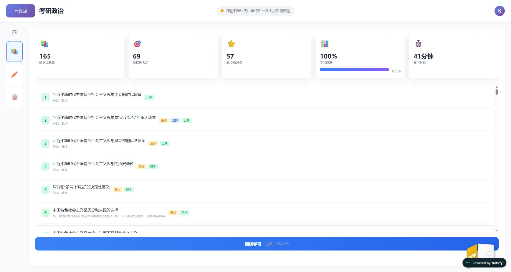
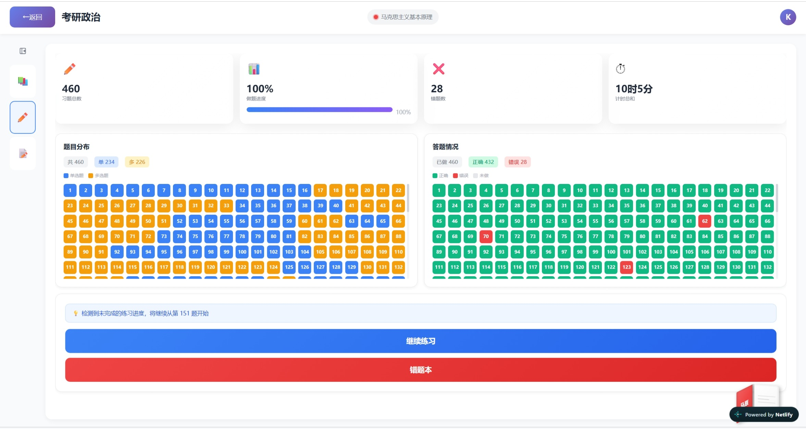
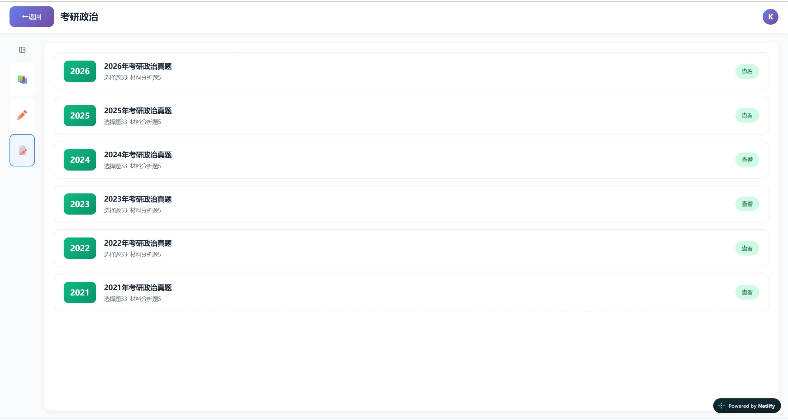

# 考研政治复习系统

> 考研政治刷题与知识点复习工具：**两种用法** —— 打开网页直接刷题，或把知识库装进你的 AI 客户端（MiMo Desktop、Claude Code、Cursor 等）对话式查知识点、出题测验。

## 🌐 在线体验

**点击直接使用：** https://review-syste.netlify.app

<p align="center">
  
  <br/>
  
  <br/>
  
</p>

## 两种使用方式

- **方式一 · 网页端**：打开链接即用，适合日常刷题，进度云端保存，手机也能用
- **方式二 · MCP 接入 AI 客户端**：把整个知识库装进你的 AI 助手，直接对话查知识点、梳理知识脉络、出题测验，全程不联网、不依赖网页

## ✨ 网页端功能

- **习题练习**：按章节做题，每道题附答案与详细解析
- **历年真题**：完整真题试卷，模拟真实考试节奏
- **知识点体系**：题目与知识点严格关联，做错了一键跳转到对应知识点巩固，也支持直接浏览五大教材的知识点
- **学习统计**：记录练习进度与正确率，复习情况一目了然
- **进度云端保存**：账号登录后数据自动同步，换设备接着刷
- **移动端适配**：手机浏览器打开即可使用，通勤随时刷题

## 🤖 方式二：在 AI 客户端中使用（MCP）

不想用网页？本项目的知识库同时打包成了一个 **MCP 服务**（本地运行、纯只读、零依赖），接入后你的 AI 助手就能精确检索考研政治知识点并按知识点出题。

**能做什么:**

- 🔍 查知识点：「查一下剩余价值相关的知识点」
- 🔗 梳理脉络：「剩余价值有哪些前置和相关知识点」
- 📝 出题测验：「出 5 道马原的单选题」（默认不带答案，做完再问 AI 要答案和解析）
- 📄 组卷：「帮我组一套马原和史纲的卷子，10 道题」

**三步接入：**

1. 从仓库下载 `mcp` 文件夹（含 `server.py` 和数据文件 `data.json`）
2. 本机安装 Python 3.8+（无需 pip 安装任何包）
3. 在 AI 客户端的 MCP 配置中添加一条本地服务

```jsonc
"mcp": {
  "kaoyan-politics": {
    "type": "local",
    "command": ["python", "改成你的路径\\mcp\\server.py"],
    "enabled": true
  }
}
```

配置完成后重启客户端，直接对 AI 说「出 5 道马原的题」就能用了。Claude Code、Cursor 等客户端的详细配置见 [mcp/README.md](./mcp/README.md)。

> 服务为纯只读、无认证、无网络请求，启动时只读取本地的 `data.json`，可放心使用。知识库规模:502 个知识点、1526 道习题，覆盖马原 / 毛中特 / 习思想 / 史纲 / 思法五大板块。

## 🎯 适合谁

- 备战考研政治、需要系统刷题的在校学生或在职考生
- 想要"做题 → 知识点 → 答疑"闭环复习体验的同学
- 习惯在 AI 助手里复习、想把知识库接进自己工作流的人

## 📖 网页端使用方式

1. 打开上面的在线链接
2. 注册 / 登录账号（用于保存学习进度）
3. 进入考研政治模块，选择章节练习、历年真题或测验模式
4. 做题后可查看解析，错题支持跳转关联知识点巩固
5. 遇到难题随时使用 AI 答疑

## 🛠️ 技术栈

- 网页端：React + Vite + Tailwind CSS，后端 Supabase（数据存储与用户认证），部署于 Netlify
- MCP 服务：Python 标准库实现，无第三方依赖

## ❓ 常见问题

**需要注册吗？** 网页端需要，注册后做题进度、统计数据才会云端保存。用 MCP 则完全不需要注册，本地即用。

**手机能用吗？** 网页端可以，页面已做移动端适配，手机浏览器直接打开。

**内容收费吗？** 完全免费，仅用于学习交流。

## 📮 联系与反馈

使用中遇到问题或有建议，欢迎在网页端右上角反馈留言。

---
*本项目仅供学习交流使用，不用于商业目的。*
